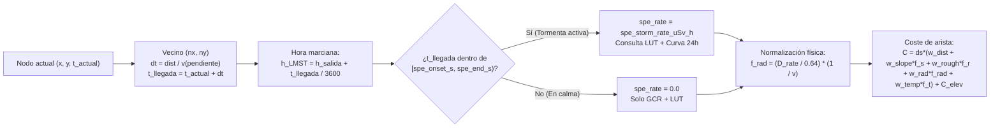

# Modelo Físico Ambiental (GCR, Tormentas Solares SPE y Temperatura) e Integración en el Pathfinding $A^*$

> **Documento Técnico y de Presentación — Proyecto Speisaps (Gale Crater, Marte)**  
> Este documento detalla la base física, matemática y algorítmica del subsistema ambiental (`radiation_data/`) y su acoplamiento espacio-temporal con el motor de navegación $A^*$ (`pathfinder/`), diseñado tanto para la coordinación del equipo como para la defensa ante el jurado.

---

## 1. Resumen Ejecutivo (Pitch para la Presentación)

En Marte no existe un campo magnético dipolar global y la atmósfera de $\text{CO}_2$ tiene apenas un $\sim 1\%$ de la densidad terrestre ($\sim 6\text{ mbar}$). Como resultado, un explorador humano o rover en el cráter Gale está expuesto a tres amenazas ambientales acopladas al terreno y a la hora solar (LMST):

1. **Radiación Cósmica Galáctica (GCR):** Flujo basal continuo de partículas relativistas ($\sim 26.7\text{ }\mu\text{Sv/h} \approx 0.64\text{ mSv/día}$ medidos por el detector **MSL/RAD** de Curiosity), modulado cada día por la marea térmica de presión atmosférica y apantallado parcialmente por la topografía local, pero con un suelo irreductible del **15 % por albedo neutrónico** del regolito.
2. **Tormentas de Partículas Solares (SPE / SEP):** Eventos transitorios (erupciones solares y CMEs) donde el flujo de protones energéticos se multiplica por $5\times$ a $20\times$ durante horas. A diferencia de los GCR, el espectro de protones solares es más blando y direccional: **no genera el 15 % de rebote neutrónico del subsuelo**, por lo que refugiarse junto a escarpes, cañones o paredes de cráter reduce drásticamente la dosis recibida.
3. **Ciclo Térmico Extremo (Modelo Parton-Logan + Lapse Rate):** Oscilaciones diurnas desde **$-81\text{ }^\circ\text{C}$** al amanecer hasta **$-13\text{ }^\circ\text{C}$** a media tarde (calibradas con **MSL/REMS**), con un desfase de inercia térmica de $2.5\text{ h}$ tras el mediodía y enfriamiento por altitud ($-2.0\text{ K/km}$).

Nuestro motor en C precalcula una **Look-Up Table (LUT) de apantallamiento topográfico de $4010 \times 3600$ píxeles** mediante trazado de rayos a $2\,500\text{ m}$ de horizonte sobre el DEM de HiRISE y permite que el algoritmo **$A^*$ espacio-temporal** modifique el trazado de la ruta en tiempo real ante una alerta de tormenta solar SPE.

---

## 2. Física del Modelo de Radiación y Tormentas Solares (SPE)

### 2.1. Curva Basal Diurna de 24 h (`rad_baseline_24h.bin`)
A partir de los ficheros oficiales RDR del instrumento **RAD (Radiation Assessment Detector)** a bordo del rover Curiosity en Gale Crater (`prepare_rad_inputs.py`), se extrae la dosis absorbida en tejido ($\mu\text{Gy/h}$) y se convierte a tasa de dosis equivalente ($\mu\text{Sv/h}$) aplicando el factor de calidad medio medido en superficie marciana ($Q = 3.05$, *Hassler et al., 2014, Science*):

$$\dot{D}_{\text{GCR, open}}(t_{\text{LMST}}) = \frac{\dot{D}_{\text{RAD}}(t_{\text{LMST}}) \cdot Q}{f_{\text{open}}}$$

- **Por qué varía con la hora del día:** Durante el día marciano, el calentamiento solar genera una **marea térmica atmosférica** que varía la columna de masa de $\text{CO}_2$ sobre el cráter Gale. Al amanecer (`06:00–08:00 LMST`), la presión superficial es máxima (mayor columna de gas arriba $\rightarrow$ mayor atenuación $\rightarrow$ mínima radiación). Por la tarde (`16:00–18:00 LMST`), la columna atmosférica se adelgaza y la dosis basal sube.

---

### 2.2. Blindaje Topográfico y Factor de Visión Celeste (`gale_shielding_lut.bin`)
Para cada celda $(r, c)$ del DEM de Gale Crater, lanzamos $N_{\text{rays}} = 32$ rayos acimutales con $100$ pasos radiales logarítmicos hasta una distancia máxima de **$2\,500\text{ m}$** con interpolación bilineal (`compute_topographic_shielding_lut` en `mars_env.c`).

En cada dirección acimutal $\phi_k$, se determina la pendiente máxima del horizonte $\tan\gamma_k = \max_s \frac{z(s) - z_0}{d(s)}$ y se integra el **Sky-View Factor efectivo ($\text{SVF}_{\text{eff}}$)**:

$$\text{SVF}_{\text{eff}}(r, c) = \frac{1}{N_{\text{rays}}} \sum_{k=0}^{N_{\text{rays}}-1} \cos^2(\gamma_k) = \frac{1}{N_{\text{rays}}} \sum_{k=0}^{N_{\text{rays}}-1} \frac{1}{1 + \tan^2(\gamma_k)} \in [0, 1]$$

En la LUT almacenamos el **factor topográfico GCR** que incluye el suelo de albedo del regolito ($\alpha_{\text{reg}} = 0.15$):

$$\text{topo\_factor}(r, c) = \alpha_{\text{reg}} + (1 - \alpha_{\text{reg}}) \cdot \text{SVF}_{\text{eff}}(r, c) = 0.15 + 0.85 \cdot \text{SVF}_{\text{eff}}(r, c)$$

---

### 2.3. Separación Física entre Calma (GCR) y Tormenta Solar (SPE)
En tiempo de ejecución ($O(1)$), la función `get_radiation_dose_rate()` recupera $\text{topo\_factor}(r, c)$ de la LUT y despeja el factor de cielo abierto puro:

$$\text{SVF}_{\text{eff}}(r, c) = \max\!\left(0,\; \frac{\text{topo\_factor}(r, c) - 0.15}{0.85}\right)$$

La tasa de dosis total recibida (en $\mu\text{Sv/h}$) es:

$$\boxed{\dot{D}_{\text{total}}(r, c, t_{\text{LMST}}) = \Big[ \underbrace{\dot{D}_{\text{GCR, open}}(t_{\text{LMST}}) \cdot \text{topo\_factor}(r, c)}_{\text{GCR (con 15\% de albedo neutrónico subterráneo)}} + \underbrace{\dot{D}_{\text{SPE, extra}} \cdot \text{SVF}_{\text{eff}}(r, c)}_{\text{Tormenta SPE (bloqueada 100\% por la roca)}} \Big] \cdot S_{\text{vehículo}}}$$

donde:
- $\dot{D}_{\text{SPE, extra}}$ es la tasa adicional en $\mu\text{Sv/h}$ aportada por la tormenta solar a cielo abierto (`0.0` en calma; p. ej. `150.0` a `500.0 uSv/h` en una SPE).
- $S_{\text{vehículo}}$ es el factor de transmisión del blindaje del explorador:
  - **$S_{\text{EVA}} = 1.00$** para un astronauta a pie en traje EVA (protección despreciable frente a protones rápidos y secundarios).
  - **$S_{\text{Rover}} = 0.85$** para la estructura metálica de un rover presurizado/chasis tipo Curiosity.

> **Punto clave para la presentación:** Esta ecuación explica por qué el relieve importa el doble durante una emergencia solar: el término SPE depende de $\text{SVF}_{\text{eff}}$ sin el suelo de $0.15$, por lo que pegarse a la pared de un cañón o mesa rocosa (donde $\text{SVF}_{\text{eff}}$ cae drásticamente) corta de raíz la radiación de la tormenta.

---

## 3. Modelo Térmico Diurno y Altimétrico (`get_mars_temperature`)

Implementado en `mars_env.c` siguiendo la curva asimétrica de **Parton-Logan** calibrada con las mediciones de **MSL/REMS** (*Martínez et al., 2017*):

1. **Fase diurna ($06:00 \le t \le 18:00\text{ LMST}$):** Calentamiento senoidal con retardo térmico $\Delta t_{\text{lag}} = 2.5\text{ h}$ (el pico térmico ocurre a las `14:30 LMST`, no a las `12:00`):
   $$f_{\text{día}}(t) = \sin\!\left(\pi \frac{t - t_{\text{amanecer}}}{L_{\text{día}} + 2\Delta t_{\text{lag}}}\right)$$
2. **Fase nocturna ($18:00 < t < 06:00\text{ LMST}$):** Enfriamiento radiativo exponencial continuo desde la puesta de sol con constante de decaimiento $b = 2.2$:
   $$f_{\text{noche}}(t) = f(t_{\text{atardecer}}) \cdot \frac{e^{-b \cdot \Delta t_{\text{noche}} / L_{\text{noche}}} - e^{-b}}{1 - e^{-b}}$$
3. **Gradiente adiabático / Lapse Rate topográfico ($-2.0\text{ K/km}$):** Usando la elevación real $z(r, c)$ del DEM de HiRISE respecto a la cota base del cráter ($z_{\text{base}} = -4\,500\text{ m}$):
   $$T(r, c, t) = T_{\min} + (T_{\max} - T_{\min}) \cdot f(t) - 0.002 \cdot \big(z(r, c) - z_{\text{base}}\big)$$

---

## 4. Cómo Funciona la Emergencia SPE dentro del Algoritmo $A^*$



### 4.1. Estado Dinámico (`DynamicEnvironmentState` en `params.h`)
El buscador de rutas recibe la estructura:
```c
typedef struct {
    bool   spe_active;            /* true = hay SPE en curso o prevista      */
    double spe_storm_rate_uSv_h;  /* tasa EXTRA a cielo abierto (uSv/h)      */
    double spe_onset_s;           /* inicio del SPE (s desde partida), 0=ya  */
    double spe_end_s;             /* fin del SPE (s desde partida), INFINITY */
    double vehicle_shielding;     /* transmisión: 1.0 EVA, 0.85 rover        */
} DynamicEnvironmentState;
```
- **Soporte para tormentas activas y preavisos (Forecast):** Si el sistema de alerta temprana avisa de que una tormenta SPE impactará dentro de 15 minutos (`spe_onset_s = 900`), $A^*$ evalúa los primeros 900 segundos de marcha en condiciones normales y **activa automáticamente la radiación de tormenta en las aristas cuyo tiempo estimado de paso supere los 900 segundos**.

### 4.2. Por qué $A^*$ no se bloquea, sino que esquiva la exposición (`edge_cost.c`)
En lugar de bloquear el mapa con `INFINITY` cuando hay una SPE, el coste de radiación por metro recorrido se **normaliza adimensionalmente** respecto a la dosis basal de referencia de Gale Crater ($\dot{D}_{\text{ref}} = 0.64\text{ mSv/día}$ a $1\text{ m/s}$):

$$f_{\text{rad}} = \frac{\dot{D}_{\text{tramo}}\text{ [mSv/día]}}{0.64\text{ mSv/día}} \cdot \frac{1.0\text{ m/s}}{v_{\text{efectiva}}}$$

Integrado en la función de coste total de cada arista de longitud $\Delta s$:

$$C(\text{arista}) = \Delta s \cdot \Big( w_{\text{dist}} + w_{\text{slope}} \cdot f_{\text{slope}}(\theta) + w_{\text{rough}} \cdot f_{\text{rough}}(\sigma_z) + \mathbf{w_{\text{rad}} \cdot f_{\text{rad}}} + w_{\text{temp}} \cdot f_{\text{temp}}(T) \Big) + C_{\text{elev}}(\Delta z)$$

| Escenario | $\dot{D}_{\text{tramo}}$ ($\text{mSv/día}$) | Factor $f_{\text{rad}}$ | Efecto en $A^*$ |
| :--- | :---: | :---: | :--- |
| **Calma en llanura abierta** ($\text{SVF} \approx 1.0$) | $\sim 0.64$ | $\mathbf{1.00}$ | Equilibrado con distancia y pendiente |
| **Calma en cañón abrigado** ($\text{topo} \approx 0.70$) | $\sim 0.45$ | $\mathbf{0.70}$ | Ligera preferencia por zonas resguardadas |
| **Tormenta SPE ($+150\text{ }\mu\text{Sv/h}$) en llanura** | $\sim 4.24$ | $\mathbf{6.62}$ | **Alta penalización:** evita explanadas abiertas |
| **Tormenta SPE ($+150\text{ }\mu\text{Sv/h}$) bajo escarpe** | $\sim 2.45$ | $\mathbf{3.83}$ | **$A^*$ desvía la ruta hacia la pared/cañón** |

---

## 5. Guía Rápida de Uso para el Equipo

### 5.1. Desde el Ejecutable de Rutas (`martian_pathfinder` / `martian_pathfinder.exe`)
```bash
# 1. Ruta normal en calma (a las 09:00 LMST, EVA a pie, paso 10 m)
./martian_pathfinder 137.38 -4.66 137.41 -4.685 9.0 0 10 ruta_calma.geojson

# 2. Ruta con Tormenta Solar SPE activa (+300 uSv/h extra desde el inicio)
./martian_pathfinder 137.38 -4.66 137.41 -4.685 9.0 0 10 ruta_spe.geojson --spe 300

# 3. Ruta con Alerta de Preaviso SPE (la tormenta llega a los 600 s = 10 min de marcha)
./martian_pathfinder 137.38 -4.66 137.41 -4.685 9.0 0 10 ruta_forecast.geojson --spe 300 --spe-onset 600
```

El archivo **GeoJSON** generado incluye automáticamente en `properties`:
- `"total_radiation_dose_msv"`: Dosis total acumulada en el trayecto ($\text{mSv}$).
- `"peak_dose_rate_msv_day"`: Pico máximo de tasa de dosis encontrado ($\text{mSv/día}$).
- `"spe_active"`: `true` o `false`.
- Y en cada waypoint de `geometry.coordinates`: `[lon, lat, elev_m, tiempo_s, dose_rate_msv_day, temp_c]`.

### 5.2. Desde el Frontend / Capa Ambiental (`mars_env.h`)
Para pintar mapas de calor o consultar cualquier punto $(lon, lat)$ en $O(1)$ (~20 nanosegundos por punto tras la primera carga automática en caché):
```c
#include "radiation_data/mars_env.h"

// Radiación en uSv/h (spe_multiplier = 1.0 en calma, > 1.0 ej. 5.0 o 10.0 con SPE)
float rad_uSv_h = get_radiation_dose_rate_frontend(lon_deg, lat_deg, t_lmst, spe_multiplier);

// Temperatura en °C (ajustada por la altitud real del DEM en esa coordenada)
float temp_c = get_mars_temperature_frontend(lon_deg, lat_deg, t_lmst);
```
*(También disponibles las versiones por lotes `get_radiation_dose_rate_batch_frontend`, `get_mars_temperature_batch_frontend` y de rejilla 2D completa `get_environment_grid_frontend`; ver detalle en `FRONTEND_ENV_API.md`).*

---

## 6. Referencias Científicas (para las Diapositivas)

1. **Hassler, D. M., et al. (2014).** *Mars' Surface Radiation Environment Measured with the Mars Science Laboratory's Curiosity Rover.* **Science**, 343(6169), 1244797. (Dosis basal GCR en Gale Crater: $0.64 \pm 0.12\text{ mSv/día}$, factor de calidad $Q = 3.05$, modulación por marea térmica barométrica).
2. **Martínez, G. M., et al. (2017).** *The Modern Near-Surface Martian Climate: A Review of In-situ Meteorological Data from Viking to Curiosity.* **Space Science Reviews**, 212, 295–338. (Extremos térmicos diurnos medidos por REMS en Gale Crater).
3. **Parton, W. J., & Logan, J. A. (1981).** *A model for diurnal variation in soil and air temperature.* **Agricultural Meteorology**, 23, 205–216. (Curva diurna senoidal con retardo térmico + decaimiento nocturno exponencial).
4. **Ehresmann, B., et al. (2014) / Guo, J., et al. (2017).** *MSL/RAD measurements of Solar Energetic Particle events and regolith neutron albedo on Mars.* (Separación entre el suelo del 15 % de albedo neutrónico inducido por GCR y el apantallamiento geométrico directo de protones solares SPE).
